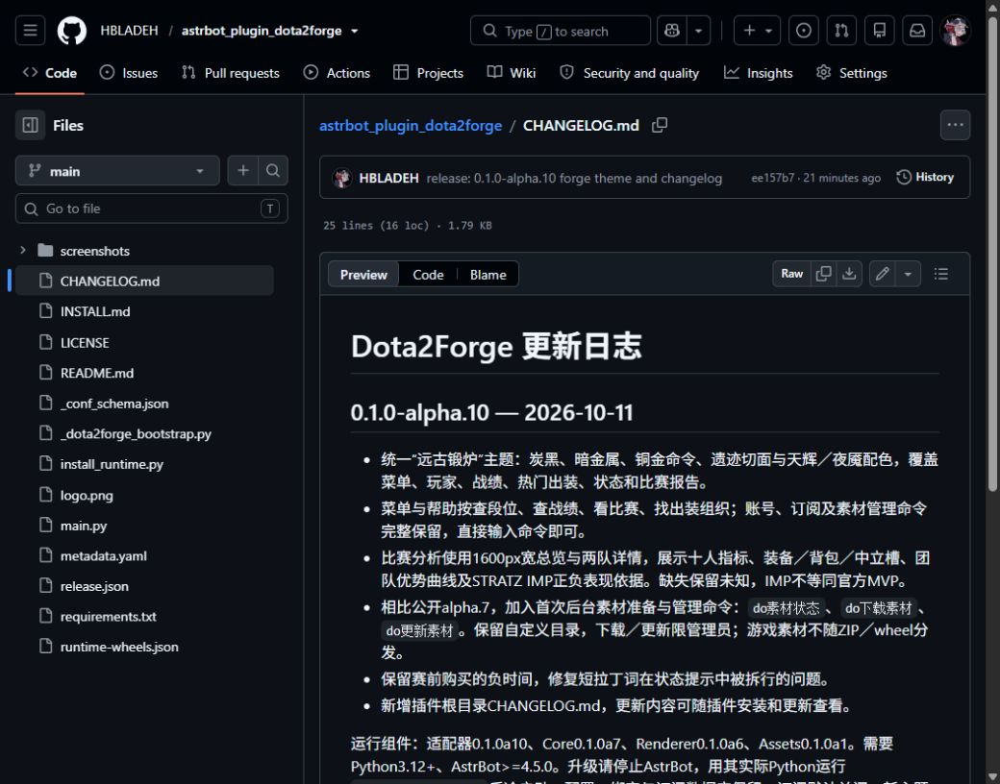

# 双端远古锻炉主题发行证据

2026-10-11按用户授权发布双端预发行，补齐AstrBot更新日志。主仓[PR #13](https://github.com/HBLADEH/Dota2Forge/pull/13)已合并，Python3.12／3.13的push与PR四个CI全部通过；[CI记录](source-ci.json)。固定源码SHA为`223967ba635ce1b6d4f3d9674eb68d3831a20dd2`。

| 插件 | GitHub Release | 分发main／tag SHA | 候选根文件 |
| --- | --- | --- | --- |
| Dota2UID | [v0.1.0a11](https://github.com/HBLADEH/Dota2UID/releases/tag/v0.1.0a11) | `86a1132eb23c77af4e1dd39526d5abaf8e3473b9` | 18 |
| AstrBot | [v0.1.0a10／host alpha.10](https://github.com/HBLADEH/astrbot_plugin_dota2forge/releases/tag/v0.1.0a10) | `ee157b7b56bac6df3115a979235d3c7c9920c6c5` | 14 |

两端均随Core a7、Renderer a6、Assets a1及自身适配器发布；UID为bundled，AstrBot requirements使用本仓Release的固定版本URL和SHA256。AstrBot根[CHANGELOG.md](https://github.com/HBLADEH/astrbot_plugin_dota2forge/blob/ee157b7b56bac6df3115a979235d3c7c9920c6c5/CHANGELOG.md)与ZIP同字节，Release正文亦包含更新说明。

[统一禁网日志](offline-final.log)exit0，2012项通过／92.49%覆盖率；scripts、Core、Assets分别94／93／92%。[分发专项](distribution-tests-passed.log)89项通过；[五包重建](build-final.log)和[五包隔离安装](wheel-smoke.log)通过。最终候选[双端SDK-free smoke](distribution-smoke.log)验证固定依赖、自动素材、配置、关闭和持久化，不依赖真实宿主SDK。

[UID匿名校验](Dota2UID-public-validation.json)与[AstrBot匿名校验](astrbot_plugin_dota2forge-public-validation.json)均通过：codeload分发提交与候选全文件一致，Release ZIP与仓库一致，各11个附件完整匿名下载与SHA256核对，标签SHA另由GitHub ref读取确认。没有覆盖旧Release资产或操作PyPI。

Cloud已通过发布页“更新插件版本”提交alpha.10，返回版本详情页；再次解析时平台明确显示现有插件当前版本alpha.10，确认提交已被接收。随后公共详情页仍显示alpha.7 Published及“暂无更新日志”；alpha.10的公开审核／缓存更新尚未确认，不能把提交写为审核通过。没有重复提交、撤回旧版或改绑仓库。后续在[Cloud版本页](https://cloud.astrbot.app/plugin/HBLADEH/astrbot_plugin_dota2forge?tab=versions)核实新版上架与日志显示；[接续任务](../../tasks/active/2026-10-11-forge-theme-release.md)。

新主题的实际宿主／QQ／AstrBot聊天、客户端压缩与订阅投递尚未验证。旧UID a6–a9首次升级冷启动；之后仅兼容bundled代际可受控重载。AstrBot升级停止宿主，用实际Python执行安装器后冷启动。配置、数据库和真实宿主均未操作。
