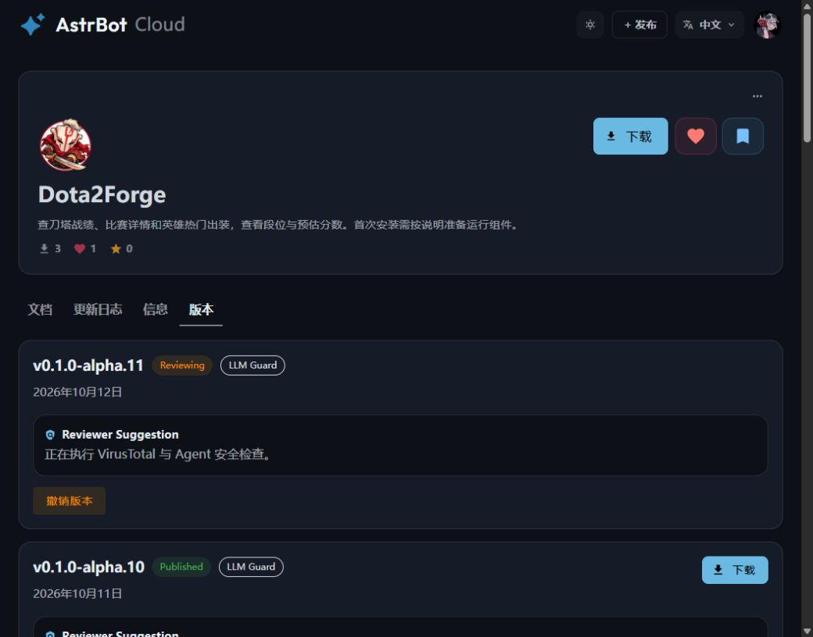

# 双端 README 预发行证据

[发行任务](../../tasks/done/2026-10-12-plugin-readme-release.md)、[发行决策](../../notes/implemented/2026-10-12-plugin-readme-release.md)。

用户授权复核后分别发布两端。源码[PR #17](https://github.com/HBLADEH/Dota2Forge/pull/17)已合并，[四项CI](source-ci.json)全部通过；[合并记录](source-merge.json)。候选固定源码SHA为`15e1a50a07273c645f0a1066b61fe266dde216cc`。

| 插件 | 公开预发行 | 分发main／tag SHA | 仓库文件／附件 |
| --- | --- | --- | --- |
| AstrBot | [v0.1.0a11／host alpha.11](https://github.com/HBLADEH/astrbot_plugin_dota2forge/releases/tag/v0.1.0a11) | `7f385694fc06c7c1b40544b5e2a60e48b16a98bd` | 20／11 |
| Dota2UID | [v0.1.0a13](https://github.com/HBLADEH/Dota2UID/releases/tag/v0.1.0a13) | `72259b18d98199d9b883da7bee48d5783cdc769f` | 24／11 |

[候选复核](candidate-validation.json)及[双端SDK-free smoke](distribution-smoke.log)通过，AstrBot ZIP为5,116,778 bytes，低于16,000,000上限；UID随包ZIP为18,912,249 bytes。先完整上传draft附件并验证GitHub大小/摘要后公开，旧Release没有覆盖。

[AstrBot匿名验证](astrbot_plugin_dota2forge-public-validation.json)与[UID匿名验证](Dota2UID-public-validation.json)均passed、anonymous=true：公开API、codeload树、ZIP、各11个附件完整下载与SHA256全部一致。标签及main SHA另核对。AstrBot根/ZIP的CHANGELOG包含alpha.11；安装器依赖仍固定本仓Release版本/摘要。发布清单见[AstrBot](astrbot_plugin_dota2forge-release-assets.json)、[UID](Dota2UID-release-assets.json)。

[隐私复核](privacy-validation.json)确认七张图片与审查摘要一致：40个身份遮挡矩形、原分辨率和遮挡外像素均符合记录，原件未改变，无文本元数据。[共享包复核](shared-packages-validation.json)确认Core a7、Renderer a6、Assets a1的三份wheel及三份sdist与公开UID a12字节一致。

[五包构建](build.log)、[五包隔离安装／导入](wheel-smoke.log)退出0；[统一离线检查](offline-check.log)2013项通过，覆盖率92.52%，Ruff/mypy及scripts、Core、Assets门槛通过。最终文案精简后[分发专项](distribution-tests-final.log)89项通过，文档治理与格式/lint再次通过，[最终五包重建](build-final.log)退出0。真实宿主和聊天未操作。

专项首轮两项失败为旧断言仍要求已移除的拍摄待办／生成器链接，保留[原日志](distribution-tests.log)，改为对实际订阅／后台配置指南验证同样的固定源码引用与非安装链接隔离。两种source_ref、安装页、许可和来源断言均保留。第一次尝试重复传uv build的--package参数失败，见[参数错误](adapter-build-final.log)；改用既有五包命令成功，未跳过构建。

[公开图片验证](readme-assets-validation.json)确认AstrBot图标及七张raw图片匿名取得且字节与候选相同；GitHub实页四项导航为居中，玩家/战绩图片正确加载并保留780px原宽。GsCore相对路径及全部文件通过相同分发契约/匿名仓库检查。

首轮main出装图响应不一致，未记录该次响应摘要；再次核对main和固定分发提交均匹配，随后原README的八个URL全部通过。原因未证实，不把缓存推测写成确定原因。发行指南初次4130字符超预算，去除重复历史链接后复核；未调整policy或门槛。

[Cloud基线](cloud-baseline.json)确认alpha.10 Published且日志非空，前次发行待确认项完成。本次表单正确解析alpha.11和同名仓库，只提交一次“更新插件版本”，返回版本页显示Reviewing，[提交记录](cloud-submission.json)。刷新后仍在执行安全检查，不能记为上架通过；实时状态见[Cloud版本页](https://cloud.astrbot.app/plugin/HBLADEH/astrbot_plugin_dota2forge?tab=versions)。

分发同步首个包含删除的shell命令被自动审批拒绝（仅返回blocked by policy）；改为将旧UID a12 wheel移到本地ignored备份，再复制新候选成功。两份本地候选、旧文件与旧公开发行保留。没有操作生产宿主、配置、数据库、凭据或真实聊天；主动订阅、其他平台权限及新主题实际客户端仍单独验收，英雄攻略和AI Tool尚未实现。
