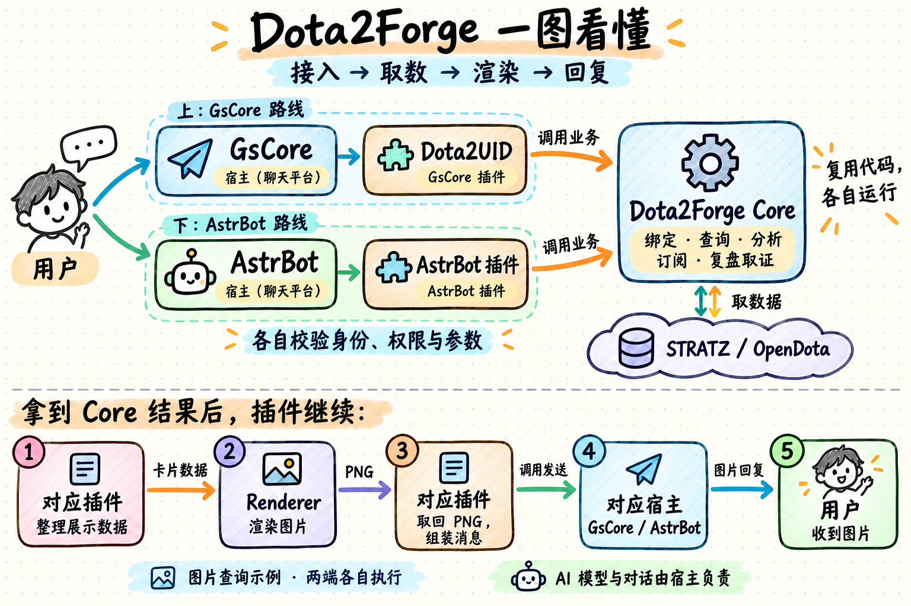
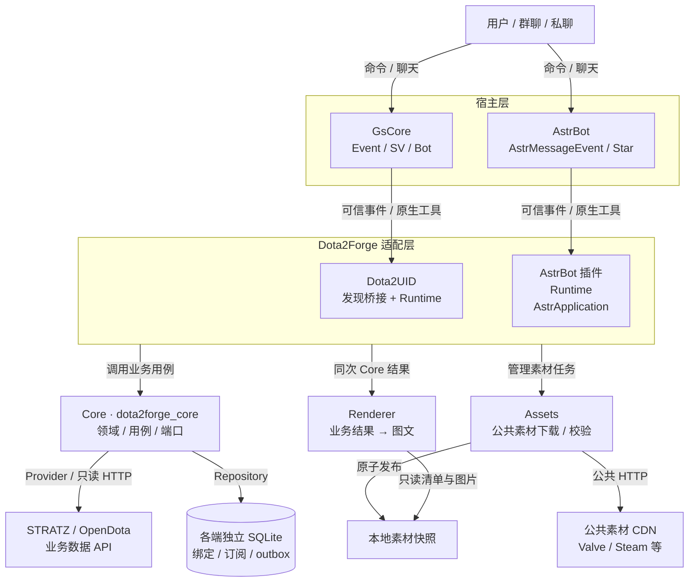
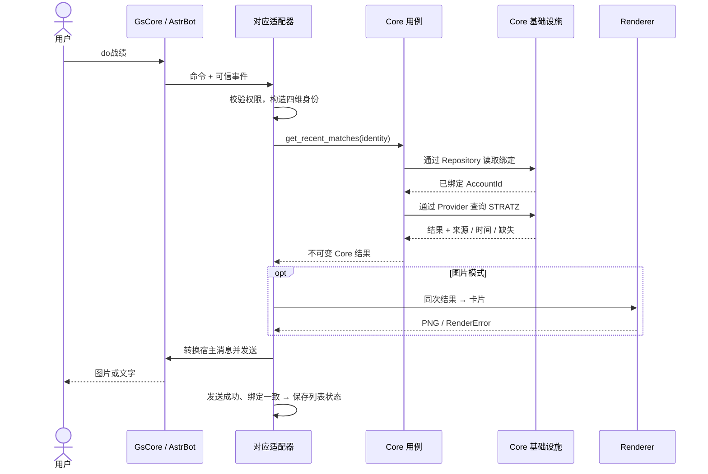
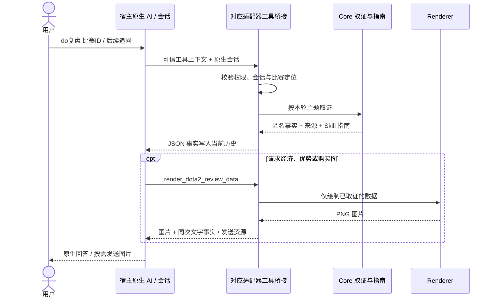

# GsCore / AstrBot 适配与交互图

以 2026-10-17 工作区源码及[架构契约](../architecture.md)为准。项目仍处 M0 预发行；图中是已实现的源码结构，安装版本与真实验收范围另见文末。

## 手绘速览

以图片查询为例：插件拿到 Core 业务结果后整理展示数据，调用 Renderer 生成 PNG，再组装消息，经对应宿主发给用户。两端各自执行；Core 负责业务，Renderer 负责画图。文字模式跳过渲染，模型和对话由宿主负责。

## 总览：两个入口，复用共享组件

实线表示调用或数据传递，返回路径见时序图。从适配层引出的三条箭头对两端分别成立，Core、Renderer、Assets 是共享包。共享表示复用代码：各端在自己的宿主进程内创建实例，通过 Python 调用；没有集中式 Core HTTP 服务。两个适配器互不导入，也不默认共用数据库。

Core 内部由领域和用例依赖 `ports.py` 的 Provider / Repository 协议，`infrastructure/` 实现 HTTP、SQLite、缓存等 I/O；Runtime 显式构造并注入实现。Core 不导入平台 SDK、不调用 LLM、不调度或发送消息。Renderer 消费 Core 不可变结果，不联网；Assets 不依赖其他项目包，由适配器管理并将本地路径注入 Renderer。

普通玩家、战绩、比赛、英雄强势与攻略使用 STRATZ；热门出装使用 OpenDota。仅复盘显式启用受限的 STRATZ → OpenDota 整份证据回退，不跨源补字段；通用缓存/重试装饰器的存在不代表普通查询已启用它们。见[来源与回退](review-skill.md)。

## 一次战绩查询怎样返回

下图以已绑定、查询成功的主线说明两端流程；AstrBot 命令按配置添加唤醒前缀。桥接将宿主 Event 或 AstrMessageEvent 转为可信 Caller，原始平台事件不会传进 Core。

四维身份为 `namespace / platform / bot_id / user_id`，只从可信配置与事件生成。GsCore 使用受控平台映射、`bot_self_id` 和 `user_id`；AstrBot 还将连接与机器人组合成隔离标识。绑定保存在专用 Core SQLite，不双写 GsCore 的多 UID Bind 表。分页、列表序号和复盘定位属于适配器会话状态，改绑、解绑、停用或重载会清理。

未绑定、来源明确为空、字段未知、Provider 失败与存储失败分别处理。仅已知渲染错误回退同次数据文本，不重查 API；取消、程序错误和发送失败不吞掉，也不自动重发。

## 订阅怎样主动推送

1. 用户显式订阅，适配器校验当前可信目标；群订阅要求当前 Bot 管理员。两端默认关闭订阅。
2. GsCore 桥接注册 APScheduler job；AstrBot 桥接持有 asyncio timer。计时器调用 Core 的有限轮询，Core 不启动后台循环。
3. Core 将检查点和待发事件写入独立订阅库的 outbox；适配器发送前原子 claim，准备完整图文，再调用宿主发送。
4. 收到明确接受回执才 acknowledge；不确定、失败或取消保留尝试，不盲重发。人工 retry 仍可能重复，两端不同库不跨平台去重。AstrBot 主动推送目前仅实现 OneBot v11 反向 WebSocket。见[完整契约](subscriptions.md)。

## AI 复盘怎样沿用宿主会话

GsCore 使用 `ToolContext`、原生 session 与 hooks，并在兼容 SDK 上注册 `dota2-review` Skill；图片通过宿主资源管理器交给发送工具。AstrBot 使用 `conversation_manager`、`event.request_llm(conversation=...)` 和 `llm_tool`；工具结果附带同一指南，图片从当前可信事件发送。模型、历史、人格工具权限及预算由宿主拥有；Core 只提供事实和指南，后续消息继续走宿主原生聊天管线。

## 两种 AstrBot 接法与运行边界

- **独立插件**：平台 → AstrBot → `astrbot_plugin_dota2forge` → 共享组件，可以单独运行，不要求 GsCore。
- **宿主转发**：平台 → AstrBot 的 GsCore 平台适配器 → GsCore → Dota2UID → 共享组件。这是另一种宿主拓扑，不是两个 Dota2Forge 插件互调。[2026-10-13 部署记录](../../.agents/artifacts/subscription-match-cards-release-v1/README.md)中的服务器采用此路径，当时没有安装独立 AstrBot 业务插件；不据此推断今天的实时部署状态。

Runtime 拥有配置、专用 HTTP 客户端、数据库仓库、Renderer、Assets 及会话缓存；桥接拥有宿主命令/工具注册和调度。加载初始化，停用先拒绝新请求并取消、排空任务，再关闭资源。合法空 Token 进入 awaiting_config，公共素材可独立准备。GsCore bundled 另有私有 wheel 代际与受控重载管理；薄模式、旧版首次升级和 AstrBot 的更新按各自安装契约处理，卸载不能只删除插件目录。

基础查询图片与生命周期已有 GsCore/QQ、AstrBot/OneBot 单会话验收；GsCore 原生多轮及补图有用户局部自测确认。AstrBot 完整多轮、跨会话/权限/过期/重载矩阵及新订阅卡真实递送仍未完整验收。尚未接入死亡、团战、视野、轨迹或录像事件，AI 不具备这些事实。版本、商店与部署整合状态见[发行指南](../cookbook/plugin-release.md)、[真实复盘任务](../../.agents/tasks/active/2026-10-14-native-review-live-acceptance.md)和[订阅任务](../../.agents/tasks/active/2026-10-02-subscriptions.md)。

## 从图找到代码

| 要理解的部分 | 入口 |
| --- | --- |
| GsCore 发现、命令与生命周期 | [桥接模板](../../adapters/Dota2UID/src/Dota2UID/host_entry.py.template)、[组合 Runtime](../../adapters/Dota2UID/src/Dota2UID/runtime.py) |
| AstrBot 发现、消息与原生会话 | [main 模板](../../adapters/astrbot_plugin_dota2forge/src/astrbot_plugin_dota2forge/host/main.py.template)、[Runtime](../../adapters/astrbot_plugin_dota2forge/src/astrbot_plugin_dota2forge/runtime.py)、[AstrApplication](../../adapters/astrbot_plugin_dota2forge/src/astrbot_plugin_dota2forge/application.py) |
| 共享规则与 I/O 边界 | [用例](../../packages/dota2forge-core/src/dota2forge_core/use_cases.py)、[端口](../../packages/dota2forge-core/src/dota2forge_core/ports.py)、[基础设施](../../packages/dota2forge-core/src/dota2forge_core/infrastructure/) |
| 图文与素材 | [Renderer](renderer.md)、[Assets](assets.md) |
